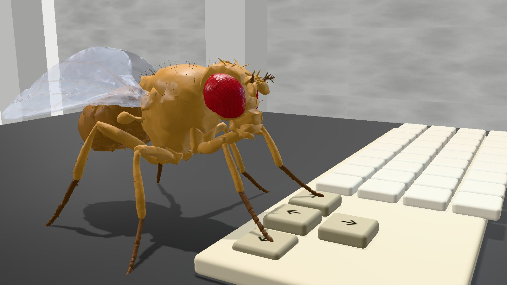
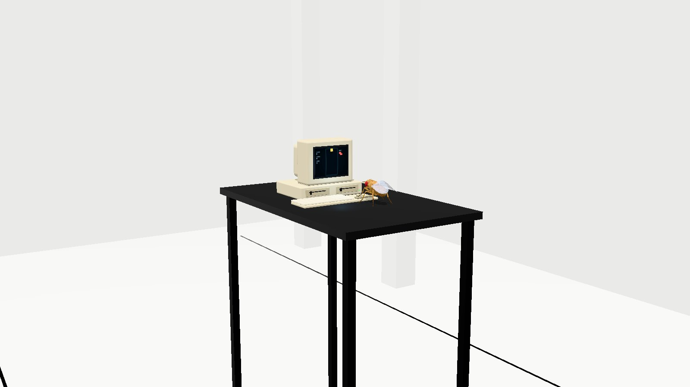
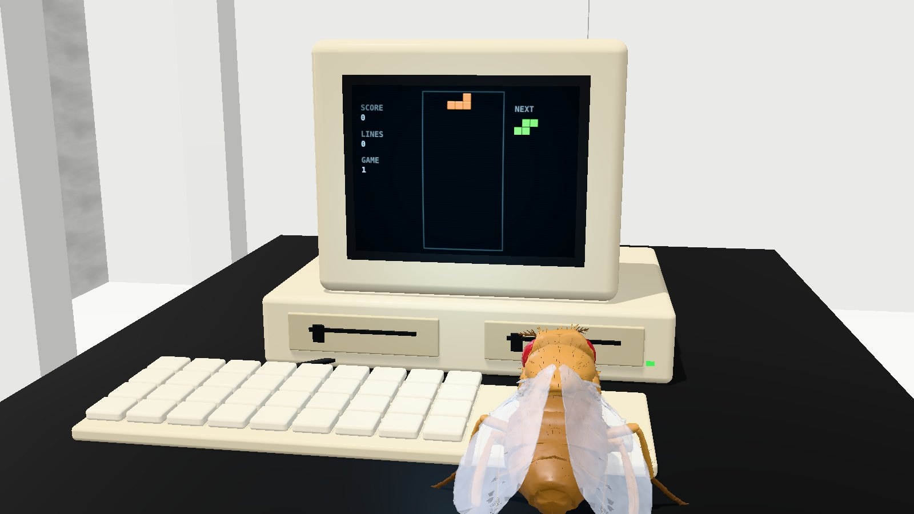
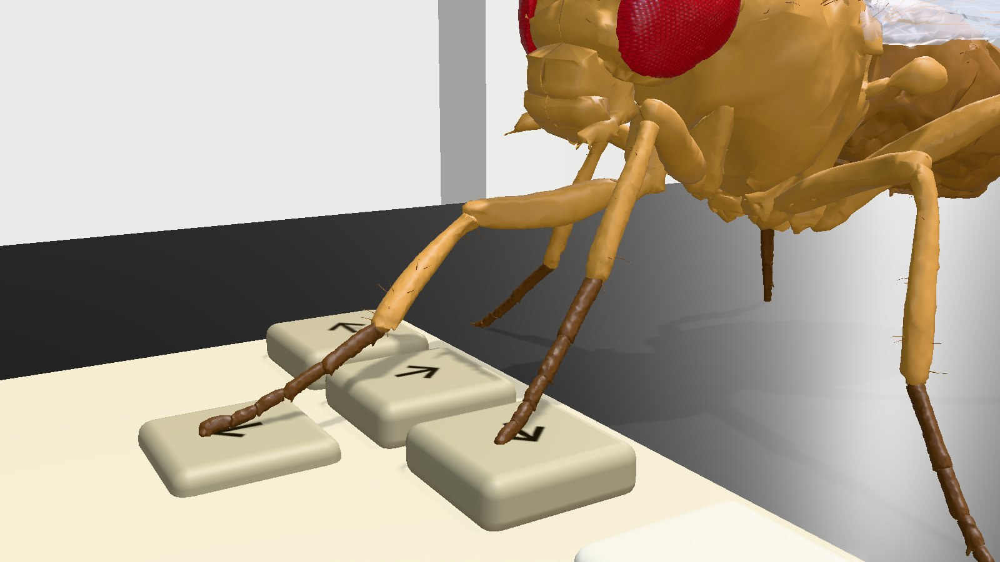
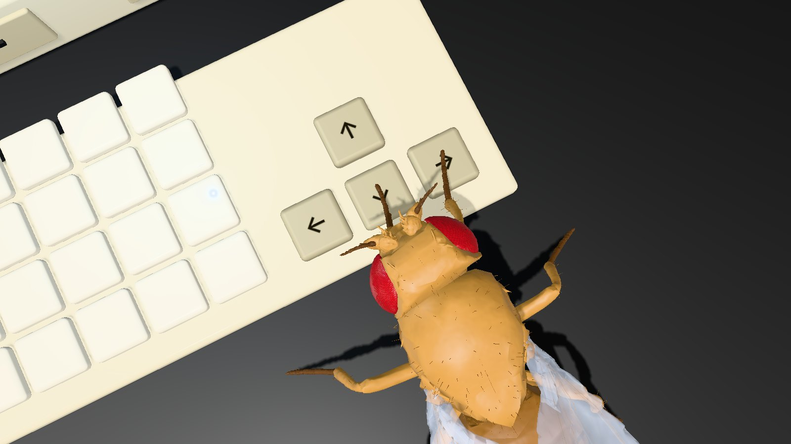
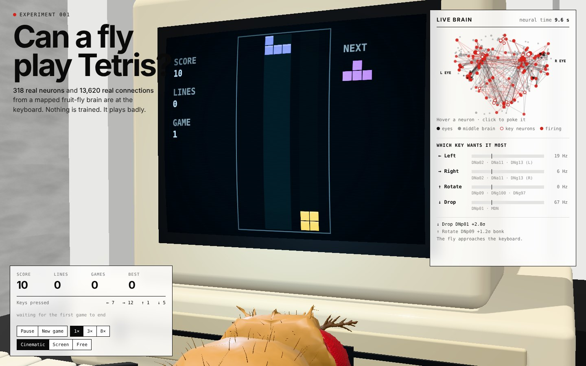
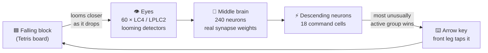

<div align="center">



# Can a fly play Tetris?

**I gave a fruit fly a keyboard.**<br/>
318 real neurons from a mapped fly brain. A real fly body. An old box computer in a white concrete bunker.<br/>
Nothing is trained. It plays badly.

[](https://harrisongreener.github.io/can-a-fly-play-tetris-/)


</div>

---

## The idea

What happens if you take a real fly's brain wiring, plug its eyes into a game of Tetris, and wire its own command neurons to the arrow keys?

That's the whole experiment. The fly's **brain** is a 318-neuron slice of the [MaleCNS connectome](https://male-cns.janelia.org/), a complete synapse-level map of a fruit fly's nervous system. Every connection weight is a real synapse count. The fly's **body** is [NeuroMechFly](https://github.com/NeLy-EPFL/flygym), a model reconstructed from microscope scans of a real fly. Nothing is tuned to play well, so it doesn't.

<table>
  <tr>
    <td width="50%"></td>
    <td width="50%"></td>
  </tr>
  <tr>
    <td align="center"><sub><b>The bunker.</b> White concrete, strip lights, one black desk.</sub></td>
    <td align="center"><sub><b>Over the shoulder.</b> The game runs live on the CRT.</sub></td>
  </tr>
  <tr>
    <td width="50%"></td>
    <td width="50%"></td>
  </tr>
  <tr>
    <td align="center"><sub><b>The keys.</b> Front legs posed with inverse kinematics.</sub></td>
    <td align="center"><sub><b>Top down.</b> Feet on ← and →, ready to tap.</sub></td>
  </tr>
</table>

## Live brain



The panel in the corner shows the fly's brain as it plays. Each dot is a neuron at its **real position in the fly's brain**, flashing red when it fires, with lines tracing signals along its strongest connections. Hover a neuron to see its cell type and neurotransmitter, or click it to poke it and watch what happens. The meters show which key's neurons are most excited at that moment, and the log explains every press, e.g. `↓ Drop  DNp01 +2.8σ`.

## How it works



| Stage | Neurons | What happens |
|---|---|---|
| **Eyes** | 60 × **LC4 / LPLC2**, the fly's looming detectors: the cells that fire when something is about to hit it | The left eye watches the left half of the board and the right eye the right. Blocks loom harder as they fall, and tall stacks loom too. The faint blue columns on the CRT show what each eye sees. |
| **Middle brain** | 240 neurons: the strongest real paths between those eyes and the command neurons | Leaky integrate-and-fire model ([Shiu et al., 2024](https://www.nature.com/articles/s41586-024-07763-9)), stepped every 0.1 ms. Excitatory or inhibitory sign comes from each cell's neurotransmitter. |
| **Keys** | 18 **descending neurons**, the cells that carry commands from brain to body | **←** turn-left cells (DNa02 / DNa11 / DNg13, left) · **→** turn-right cells (same, right) · **↑ rotate** walk-forward cells (DNp09 / DNg100 / DNg97) · **↓ drop** escape cells (DNp01 giant fibre, MDN) |

Every 120 ms of brain time, each key group's firing rate is compared with its own recent average. The group that is most unusually active presses its key, and the fly's front leg reaches over and taps it.

The fly behaves like a fly in other ways too. It rubs its front legs together when it's idle, its antennae twitch, its abdomen breathes, and its wings flick when it slams the drop key.

> **Honest caveats.** The wiring and the body are real. How the board becomes eye input, how neurons become key presses, and how the legs move are my design choices. The slice is cut out of a much bigger brain, so it's missing most of its context. This is an art piece and a toy, not a neuroscience result. A real fly would just fly away.

## Under the hood

- **No framework, no build step.** Plain JavaScript plus [three.js](https://threejs.org) from a CDN. Open `index.html` and it runs.
- **Spiking brain in the browser.** A leaky integrate-and-fire simulation of 318 neurons and 13,620 synapses, running in real time on the CPU.
- **Real fly, real skeleton.** 39 NeuroMechFly meshes on their measured joint hierarchy. Procedural shaders add compound-eye facets, wing veins and cuticle texture, and bristles are scattered over the surface.
- **Inverse kinematics.** A damped-least-squares solver, limited to the biological joint ranges, places the feet on the keys. The middle and hind feet stay planted on the desk.
- **Cinematic camera.** It drifts slowly between six framed shots, and you can drag to take over. *Screen* mode watches over the fly's shoulder and *Free* mode lets you orbit.
- **Look.** Neutral tone mapping, soft shadows, selective bloom on the strip lights and CRT phosphor, and scanlines on the screen.

## Run it locally

```sh
git clone https://github.com/HarrisonGreener/can-a-fly-play-tetris-.git
cd can-a-fly-play-tetris-
# then just open index.html, or:
python -m http.server 8000   # → http://localhost:8000
```

It needs an internet connection on first load to fetch three.js and fonts from CDNs.

<details>
<summary><b>Project structure</b></summary>

```
index.html, style.css            the page and HUD
js/brain.js                      spiking neuron simulation (LIF)
js/interface.js                  board → eyes, descending neurons → keys
js/tetris.js                     the game
js/fly3d.js                      3D fly: meshes, skeleton, shading, leg IK
js/world.js                      bunker, desk, computer, keyboard, lights, camera
js/views.js                      CRT screen drawing, live brain map
js/main.js                       main loop and HUD
data/brain-slice.js              318-neuron connectome slice (generated)
data/fly-body.js                 packed NeuroMechFly body (generated)
tools/make_slice.py              rebuilds the brain slice from the full connectome
tools/pack_fly.py                packs the fly meshes and skeleton for the web
tools/download_full_dataset.sh   fetches the full MaleCNS dataset (~1.1 GB)
docs/screenshots/                README images
licenses/                        third-party licences and notices
```

Both data files are generated from a clone of [Xenova/fruit-fly-simulation](https://huggingface.co/spaces/Xenova/fruit-fly-simulation) (clone with Git LFS installed):

```sh
pip install numpy
python tools/make_slice.py path/to/fruit-fly-simulation/dist/data
```

</details>

## Credits

This project stands on some remarkable open science:

- **Connectome:** [MaleCNS v1.0](https://male-cns.janelia.org/), by FlyEM / HHMI Janelia, University of Cambridge, MRC LMB and Google Research. [CC BY 4.0](https://creativecommons.org/licenses/by/4.0/). `data/brain-slice.js` is a subset of this dataset.
- **Fly body:** NeuroMechFly v2, from [NeLy-EPFL/flygym](https://github.com/NeLy-EPFL/flygym). Apache-2.0. Wang-Chen et al., *NeuroMechFly v2*, Nature Methods 2024, [doi:10.1038/s41592-024-02497-y](https://doi.org/10.1038/s41592-024-02497-y).
- **Preprocessing, kinematics, surface shading, LIF reference:** adapted from [Xenova/fruit-fly-simulation](https://huggingface.co/spaces/Xenova/fruit-fly-simulation) (MIT).
- **Neuron model:** Shiu et al., *A Drosophila computational brain model reveals sensorimotor processing*, [Nature 2024](https://www.nature.com/articles/s41586-024-07763-9).
- **Rendering:** [three.js](https://threejs.org) (MIT). **Fonts:** Space Grotesk and IBM Plex Mono (SIL OFL).

Tetris® is a trademark of The Tetris Company. This is an unaffiliated, non-commercial fan project.

## Licence

Code: [MIT](LICENSE). Connectome data: CC BY 4.0. Fly body: Apache-2.0. Full notices are in [`licenses/`](licenses/).

<div align="center"><sub>Made by Harry Greener</sub></div>
